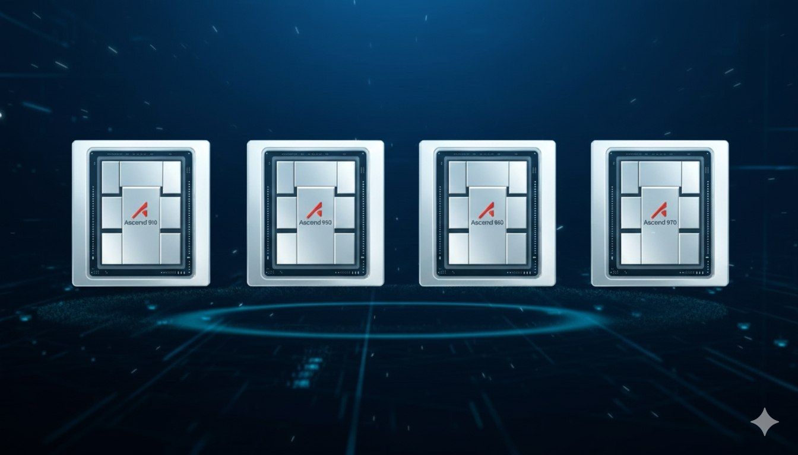

Monopoli Nvidia bakal terusik? Sepertinya iya. Kabar terbaru bilang kalau raksasa teknologi China, **Huawei**, udah siap ekspansi jualan chip AI mereka ke luar China.

## Ascend 950: Senjata Baru Q1 2026

Bintang utamanya adalah **Ascend 950**. Chip ini rencananya bakal dirilis global mulai **Kuartal 1 tahun 2026**. Target pasarnya gak main-main:

- Korea Selatan (Start awal)
- Timur Tengah
- Asia Tenggara (ASEAN)
- Afrika

### Incar Wilayah yang "Dipersulit" Nvidia

Strategi Huawei cerdik banget. Mereka nargetin wilayah-wilayah yang infrastruktur AI-nya belum mateng, atau negara yang kena imbas regulasi dan pajak tinggi buat beli produk Nvidia.

Jadi pas Nvidia sibuk sama regulasi ekspor AS, Huawei masuk nawarin alternatif.

## Tantangan Terbesar: Software

Tapi jalannya gak bakal mulus-mulus amat. Skeptisme terbesar dateng dari sisi software support.

Dunia AI sekarang udah nyaman banget sama ekosistem **CUDA**-nya Nvidia. Pertanyaannya: *"Developer mau gak migrasi ke **CANN** (Compute Architecture for Neural Networks) punya Huawei?"*

  <strong>Opini Gue:</strong> Kalau Huawei bisa bikin konverter code yang seamless dari CUDA ke CANN, Nvidia wajib waspada. Tapi kalau software-nya ribet, hardware kenceng pun percuma.

<em>Source: @jukan05 on X</em>

